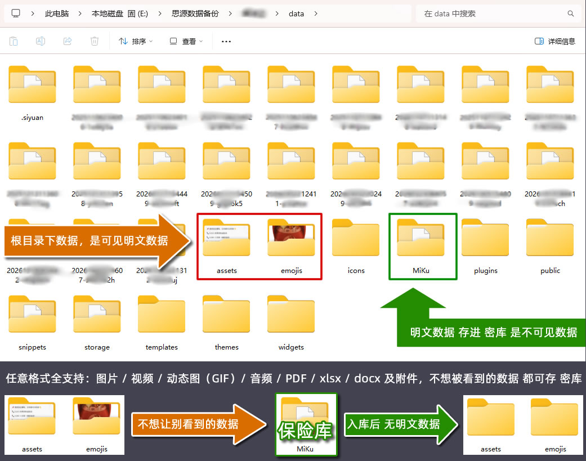
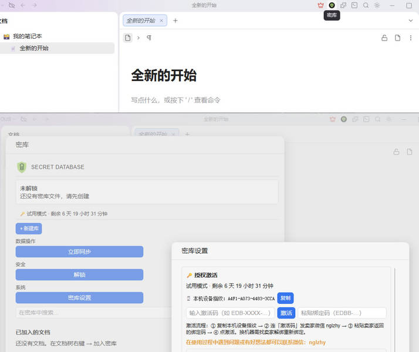
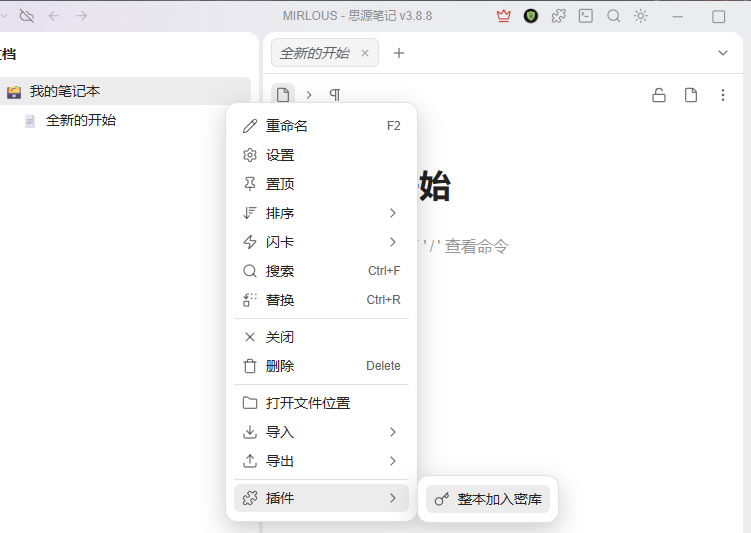
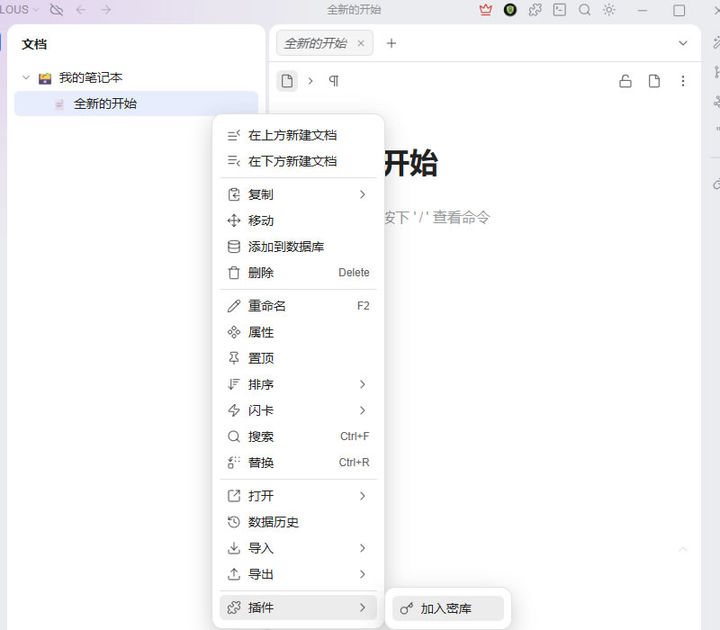

# 密库 · Secret Database

**密库 · Secret Database**

**思源笔记的「私人保险箱」——有些东西，只能你自己看**

---

---

## 先说一件你可能没想过的事

你电脑里的思源笔记，**现在是完全敞开的**。

不是"有点不安全"，是**完全敞开**——任何一个能碰到这台电脑的人，打开文件夹就能读到你写的每一个字、存的每一张图、每一段视频：

| 那个"能碰到电脑的人" | 他会看到什么 |
|---|---|
| **借电脑的朋友/亲戚** | 你随手记的心事、体检报告、私密日记 |
| **来家里修电脑的师傅** | 你所有资料，包括你压根没打算给任何人看的 |
| **公司 IT / 同事** | 你电脑上的一切（很多人电脑是公司发的） |
| **看你屏幕的人** | 你正在写的每一行字（开会投屏、旁边工位、地铁上） |
| **捡到你旧电脑的人** | 硬盘拆下来就能读，密码锁屏根本挡不住 |
| **你自己不小心** | 截图、录屏、微信发错人、云备份同步到不该去的地方 |

**你存的越私密，敞开的代价越大。**

---

## 密库解决的，不是"加密技术问题"，是"你会不会出事"

我们不跟你讲算法。只说一句人话：

> **把东西放进密库，就等于把它锁进了只有你有钥匙的保险箱。**
> 别人拿到你的电脑、拆走你的硬盘、借你的电脑、看你屏幕——
> **没有你的密码，他们一个字都看不到。**

这不是"提高了一点安全性"，是**从"完全敞开"变成"打不开"**。中间没有灰色地带。

---

## 你会因为什么买了它，并且再也不后悔

### 🚨 场景一：有人借你电脑，"我就用一下"

- **没有密库**：你手心冒汗，一直盯着他鼠标，怕他手滑点开什么。
- **有密库**：你根本不用管。密库里的东西在文档树里**根本不显示**，他连"有这些文档"都不知道。

> 这一条就够回本。**不用再为"别人碰我电脑"焦虑。**

---

### 🚨 场景二：电脑要送修 / 要卖掉 / 要借给家人用

- **没有密库**：要么把文件删了（修完没了），要么赌对方不看。
- **有密库**：数据加密在**一个文件**里，锁着就是一堆乱码。送修、卖二手、借人——拔了硬盘也读不出。

> **你可以把整台电脑交出去，而不用担心。**

---

### 🚨 场景三：屏幕被人看到的那 0.5 秒

开会投屏、工位旁边站人、地铁上邻座瞄一眼、家里人在身后走过——**你正在写的东西，别人一眼就看完了。**

- **没有密库**：来不及切窗口，内容已经露了。
- **有密库**：没解锁时正文是**糊掉的**，只显示"密库已锁定"。解锁了也有防拍照水印（带尾号），截图外传能溯源。

> **你不必再练"秒切窗口"这个技能。**

---

### 🚨 场景四：那些"存了但不敢让人知道"的资料

体检报告、病历、聊天记录备份、私人影像、学习资料、副业账目、身份证扫描件、合同、密码备忘……

**这些东西有个共同点：你确实需要留着，但绝不能被人看到。**

- 存网盘？**上传即失控**，平台、运维、泄露事件，你赌不起。
- 存普通文件夹？**等于没锁**。
- 删掉？**你又需要它。**

> **密库就是为"必须留着、又绝不能被人看到"这类东西造的。**

---

### 🚨 场景五：你以为"设了开机密码就安全了"

**不是。** 开机密码只挡"坐到电脑前的人"。

硬盘拆下来、PE 启动盘一插、或者有人拿到你的备份——**开机密码一秒失效。**

> 密库的加密在**文件本身**。硬盘离开你的电脑，它依然是一堆打不开的密文。

---

## 为什么不用别的办法？（说清楚，你才好选）

| 你的替代方案 | 实际结果 |
|---|---|
| **存普通文件夹** | 等于没锁，任何人打开就看见 |
| **存网盘 / 云笔记** | 上传那一刻就失控了。平台能看到、能被泄露、能被审核 |
| **用系统加密软件（BitLocker / VeraCrypt）** | 整盘加密：一开电脑全解锁，**挡不住"借电脑的人"**；而且和思源笔记割裂，没法一边写一边加密 |
| **压缩包加密码（zip/rar）** | 每次看都要解压一遍，改了还要重新压；**密码还能被暴力破解**，文件名也藏不住 |
| **思源自带加密笔记本** | 方向对，但**只能在思源里用、只能随着工作区走**；不能单文件带走、不能给手机看、不能分享单篇、不能网盘增量同步 |
| **密库** | **边写边加密**、**一个文件带走**、**手机上也能看**、**别人碰不到** |

---

## 密库到底给你什么（不是功能清单，是你的"能力"）

### ✅ 别人碰不到
- 锁着的东西在**文档树里不显示**，连"存在"都看不出
- 没解锁时正文**自动糊掉**，不会一闪而过
- 硬盘被拆走？加密在文件里，读不出

### ✅ 你带得走
- 所有资料收进**一个文件**（`.sydb`）
- 拷到 U 盘、移动硬盘、另一台电脑，**带一个文件就走**
- 手机/平板连同一 WiFi，浏览器输入访问码就能看（还能编辑）

### ✅ 你的东西你说了算
- **不联网也能用**，数据永远在你手里，不上传任何明文
- **网盘同步的也是加密文件**，网盘方看不懂
- **阅后即焚分享**：给别人的链接，打开一次就销毁
- **无后门**：密码不在任何地方保存，我们也打不开

### ✅ 出事了能救回来
- **恢复密钥**：建库时给你 12 个字，忘记密码能靠它找回（请抄在纸上、存别处）
- **版本历史**：每次同步前自动留快照，改错了能回滚
- **回收站**：删掉的东西先进回收站，能恢复
- **防篡改监控**：库文件被外部改动会立刻告警（防勒索软件）

### ✅ 大文件也扛得住
- 图片、视频、GIF、音频、PDF、Excel、Word——**任意格式都加密**
- 几十 GB 的视频照样存，**边播边解密**，不卡不占内存
- 库容量**只受你硬盘限制**

---

## 一句话总结

> **密库不是给"特别小心的人"用的，是给"确实有些东西不能被人看到"的人用的。**
>
> 你已经有这些东西了。它们现在就敞开着。**装个密库，把它们关上。**

---

## 快速上手

1. 安装插件 → **设置 → 密库设置**（路径默认 `data\MiKu\密库.sydb`，可改）
2. 文档树**右键文档或笔记本** →「加入密库」→ 设密码（留空 = 无密码模式）
3. 完成。之后编辑自动加密；点顶栏图标看面板

新安装自动进入 **60 天免费试用（两个月）**，无需激活即可体验全部功能。

---

## 使用说明图

**① 创建密库并设置密码**

**② 加入密库（文档 / 整本笔记本）**

**③ 购买激活码（扫码点单）**

---

## 功能速览

| 能力 | 说明 |
|---|---|
| **强加密** | AES-256 逐块加密 + Argon2id 密钥派生（OWASP 推荐抗 GPU/ASIC），密码不落盘、无后门 |
| **🔑 恢复密钥** | 建库生成 12 个中文恢复词，忘记密码可找回并重设 |
| **⚡ 改密码秒完成** | 信封式密钥设计，GB 级大库改密码不用等 |
| **无密码模式** | 密码留空 = 启动自动解锁，文件仍是完整加密字节 |
| **🔍 搜索** | 标题 / 正文全文搜索 + OCR 图片文字搜索（中文+英文） |
| **大附件流式播放** | 200MB+ 视频按 Range 边播边解密，不落明文 |
| **资产去重** | 同内容文件复用数据块，库体积不膨胀 |
| **☁️ WebDAV 同步** | 加密库上传坚果云等，多设备拉取 |
| **分库 / 智能分库** | 一文档一库 / 一主题一库；TF-IDF 语义自动归类 |
| **库内回收站** | 删除的资产先进回收站，可恢复 |
| **🕘 版本历史** | 每次同步前留存快照，可查看/导出/回滚 |
| **📋 审计日志** | 库内关键操作留痕 |
| **📱 移动端** | 同一 WiFi 手机/平板浏览器浏览、编辑、上传 |
| **🔐 TOTP 双因素** | 密码 + 6 位动态码，密码泄露也打不开 |
| **🛡 防勒索监控** | 定时校验库完整性，被改动立即告警 |
| **🔥 阅后即焚分享** | 一次性链接，打开即销毁 |
| **⚠️ 敏感信息提醒** | 出现身份证号/手机号/银行卡号时提醒保护 |

---

## 常见问题

**Q：忘记密码怎么办？**
建库时生成的**恢复密钥**（12 个中文词）可以解锁并重设密码。**请抄在纸上或存到别的设备**，不要和库文件放一起。没有恢复密钥则无法恢复——这是"无后门"的代价。

**Q：换电脑了怎么用？**
把 `.sydb` 文件拷到新电脑，用密码解锁即可。激活码绑定设备，换机请联系卖家（微信 nglzhy）。

**Q：想还原成普通思源文档？**
面板搜索 → 点文档 →「恢复为思源文档」或「导出 .md」。

**Q：库越来越大？**
解锁后面板会提示「♻ 可回收空间约 X」，到 设置 → 安全设置 →「立即压缩回收空间」。

**Q：多台设备怎么同步？**
WebDAV 里配同一网盘：A 设备「推送」，B 设备「从云端拉取」。

**Q：手机上能用吗？**
能。同一 WiFi 下用手机/平板浏览器打开内置查看器，输入访问码即可浏览（可开启编辑）。

**Q：和思源自带的加密笔记本有什么区别？**
思源自带加密是"整本笔记本+只能随工作区走"。密库是**一个文件带走**、**能手机看**、**能单篇分享**、**能网盘增量同步**、**附件单独加密**。两者不冲突，可以一起用。

---

## 授权激活

安装后 **60 天内免费试用全部功能**，之后需激活码。

- **设置 → 密库设置 → 🔑 授权激活**：粘贴激活码 + 绑定码 → 激活
- **价格**：月 **9.9** / 半年 **29.9** / 年 **49.9** / 永久 **99** 元（再次购买自动叠加）
- **绑定码**：把设置页显示的本机设备指纹发给卖家换取（一码一机）
- **购买 / 反馈**：微信 **nglzhy**（转账后发码；遇到问题带截图反馈，我们会修）

---

## 兼容性

- 桌面端思源 **v3.0.0+**（Windows / macOS / Linux）
- 移动端：官方不加载第三方插件，用内置**查看器**在手机/平板浏览器访问

## 隐私声明

- 数据**全部本地加密存储**，不上传任何明文
- WebDAV 上传的是**加密库文件**，网盘方无法解读
- 智能分库只统计本地词频，不存原文
- **密码不落盘、不联网、无后门**
